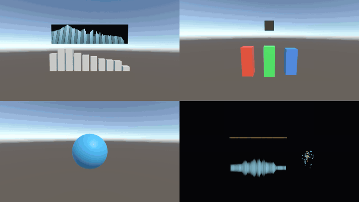
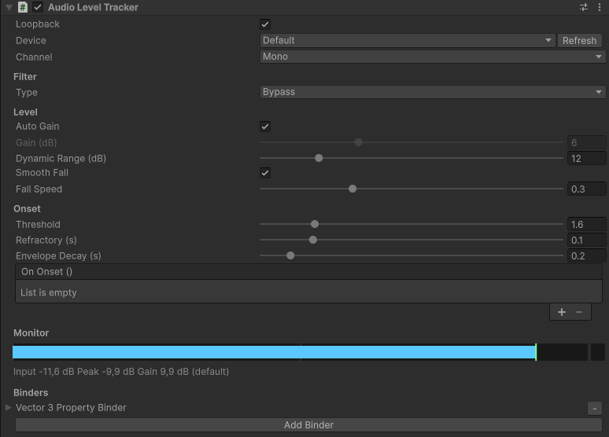
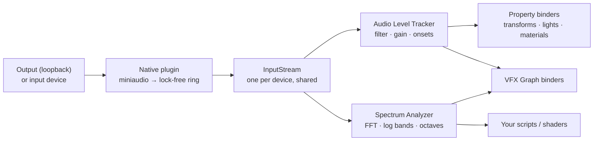
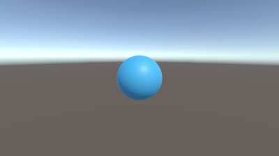
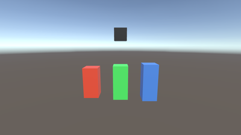
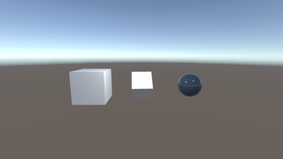
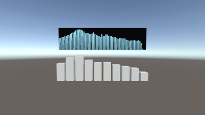
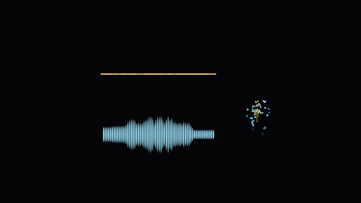

<div align="center">

# Audio Reactive

**Minimal low-latency audio-reactive toolkit for Unity 6.**
Capture a device, get a few well-behaved 0..1 signals, bind them to anything.

[](https://unity.com/releases/unity-6)
[](https://github.com/RottenEagle1337/audio-reactive/tags)
[](#platforms)
[](https://github.com/RottenEagle1337/audio-reactive-native/actions/workflows/build.yml)
[](LICENSE.md)



[Installation](#installation) · [Quick start](#quick-start) · [Components](#components) · [Samples](#samples) ·
[Roadmap](#roadmap) · [Native source](https://github.com/RottenEagle1337/audio-reactive-native)

</div>

In the spirit of [LASP](https://github.com/keijiro/Lasp) and TouchDesigner's audioAnalysis:

- **Native capture** through [miniaudio](https://github.com/mackron/miniaudio): the system output (WASAPI loopback)
  or any input device, at the device's native rate, ~10 ms buffers.
- **Audio Level Tracker**: band filter, auto gain, dynamic range, fall smoothing, onset detection.
- **Spectrum Analyzer**: log bands, ten octave levels, a spectrum texture for shaders.
- **Property binders** inside the tracker (LASP style) and **VFX Graph property binders**.
- **Live meters in the Inspector**; no per-frame allocations.

## Platforms

| Platform | Status |
|---|---|
| Windows x64 (WASAPI, loopback) | ✅ Editor and Player |
| Linux x64 (PulseAudio / PipeWire, ALSA) | 🔜 built by CI, verification planned — see [Roadmap](#roadmap) |
| macOS arm64 + x86_64 (Core Audio) | 🔜 built by CI, verification planned — see [Roadmap](#roadmap) |

On other platforms the package compiles, logs one warning and outputs silence.

## Installation

Requires Unity 6 (6000.0 or newer; developed and tested on 6000.6). Optional: Universal Render Pipeline for the
samples, Visual Effect Graph for the VFX binders.

*Window > Package Manager > **+** > Install package from git URL...*

```
https://github.com/RottenEagle1337/audio-reactive.git#v1.0.0-preview.1
```

or add to `Packages/manifest.json`:

```json
"com.rotteneagle.audioreactive": "https://github.com/RottenEagle1337/audio-reactive.git#v1.0.0-preview.1"
```

## Quick start

1. Play some music on your default output device.
2. Create a GameObject, add **Audio Reactive > Audio Level Tracker**.
3. In **Binders**, click **Add Binder > Vector3 Property Binder**, set Target to a cube's Transform and Property
   to `localScale`.
4. Enter Play Mode. The cube pulses; the tracker Inspector shows a live level meter.



## How it works



There is no source component: each tracker selects its device, and trackers selecting the same device share one
stream. Streams update lazily once per frame, so no script execution order is needed.

## Components

### Audio Level Tracker

A band-filtered level with LASP's normalization, plus onset detection. Kick / snare / hat style signals are simply
several trackers with different bands.

Outputs: `NormalizedLevel`, `InstantaneousLevel`, `Envelope`, `IsOnset`, `InputLevelDb`, `PeakDb`,
`CopyWaveform(Span<float>)`.

<details>
<summary>Settings</summary>

| Setting | Meaning |
|---|---|
| Device | Loopback (system output) or input device, device id (empty = default), channel (Mono / Left / Right). |
| Filter | Bypass, LowPass, BandPass, HighPass with editable cutoffs (Low Cutoff = high-pass edge, High Cutoff = low-pass edge). |
| Auto Gain / Gain | Normalize to the recent peak, or apply a fixed gain (dB). |
| Dynamic Range | dB below the reference mapped to 0. |
| Smooth Fall / Fall Speed | Instant rise, accelerating fall. |
| Onset Threshold / Refractory / Envelope Decay | Onset when the band energy rises above the running average × threshold; `Envelope` jumps to 1 and decays. |
| On Onset | UnityEvent invoked on every onset. |
| Binders | Property binders driven every frame by `Level` or `Envelope`. |

</details>

### Spectrum Analyzer

Outputs: `LogBands`, `OctaveLevels` (all 0..1) and `Texture` (RFloat, one texel per band).

<details>
<summary>Settings</summary>

Resolution (FFT 256..8192), 8..512 log bands from a minimum frequency to Nyquist, ten ISO octave levels
(31.5 Hz..16 kHz), auto / fixed gain over a dynamic range, attack / release smoothing.

</details>

### Property binders

| Binder | Drives |
|---|---|
| Float / Vector3 / Color Property Binder | any public writable property of that type on any component |
| Euler Rotation Property Binder | a Quaternion property (default `localRotation`) from Euler angles |
| Material Float / Material Color Binder | a shader property through a MaterialPropertyBlock |

Each binder maps its source (Level or Envelope) through an optional curve to `value0 → value1`. Setters are bound
once as delegates. A binder whose property cannot be found logs one warning.

### VFX Graph

With `com.unity.visualeffectgraph` installed, add a **VFX Property Binder** to a Visual Effect, then:

- **Audio Reactive / Audio Level**: a float from a tracker's level or envelope;
- **Audio Reactive / Audio Spectrum**: Texture2D + uint band count from a Spectrum Analyzer;
- **Audio Reactive / Audio Waveform**: Texture2D + uint sample count of a tracker's raw samples.

## Samples

Import from *Package Manager > Audio Reactive > Samples*. Each group is independent. All use URP.

| | Sample | Shows |
|---|---|---|
|  | **Level Basics** | one tracker, one binder, the inspector meter |
|  | **Bands & Onsets** | LowPass / BandPass / HighPass trackers, onset envelope, On Onset event |
|  | **Property Binders** | all six binder types on lights, transforms and materials |
|  | **Spectrum** | octave levels read from code, spectrum texture in a shader |
|  | **VFX Graph** | the three VFX binders with small graphs (needs Visual Effect Graph) |

## Scripting

```csharp
using AudioReactive;
using UnityEngine;

public class Pulse : MonoBehaviour
{
    [SerializeField] AudioLevelTracker _kick;
    [SerializeField] SpectrumAnalyzer _spectrum;

    void Update()
    {
        float bass = _spectrum.OctaveLevels[1];   // 63 Hz octave band, 0..1
        transform.localScale = Vector3.one * (1f + _kick.Envelope + bass);
    }
}
```

- Devices: `AudioSystem.GetDevices(loopback)`, `AudioSystem.RefreshDevices()`, `AudioSystem.IsLoopbackSupported`,
  `AudioSystem.IsAvailable`.
- Custom analysis: `AudioSystem.Acquire(selection)` returns a shared `InputStream` (`GetNewSamples`, `CopyLatest`,
  `GetSpectrum`); release it with `AudioSystem.Release`.

## Troubleshooting

<details>
<summary><b>Levels stay at 0</b></summary>

Nothing is playing on the selected output, or the wrong device is selected. The tracker Inspector shows the device
name; the Console logs `Stream opened: ...` once per device.

</details>

<details>
<summary><b>"Audio capture is unavailable"</b></summary>

There is no native plugin for this platform (this release: Windows x64 only).

</details>

<details>
<summary><b>A binder does nothing and logs a warning</b></summary>

The property name or type does not match. In IL2CPP players with managed code stripping, setters used only through
binders can be stripped; keep them with a `link.xml`, e.g.

```xml
<linker>
  <assembly fullname="UnityEngine.CoreModule">
    <type fullname="UnityEngine.Transform" preserve="all"/>
  </assembly>
</linker>
```

</details>

<details>
<summary><b>Replacing the native plugin</b></summary>

The Editor keeps the library loaded; close Unity first. Sources and prebuilt binaries:
[audio-reactive-native](https://github.com/RottenEagle1337/audio-reactive-native).

</details>

Enter Play Mode Options (domain reload disabled) are supported.

## Roadmap

The package stays minimal: milestones are about platforms and verification, not new analysis features.

- [x] **1.0.0-preview.1**: Windows x64 (Editor, Mono player), EditMode tests, git URL install, native CI for all
  three platforms.
- [ ] **1.0.0-preview.2 — verification**: tests on Unity 6000.0 LTS, the current LTS and the latest release;
  IL2CPP player; tests that pass without audio hardware.
- [ ] **1.0.0-preview.3 — Linux x64**: PulseAudio and PipeWire (Ubuntu 22.04 / 24.04), ALSA fallback, monitor
  sources as the system output.
- [ ] **1.0.0-preview.4 — macOS**: universal binary, microphone permission in players, loopback through BlackHole.
- [ ] **1.0.0**: all three platforms verified, minimum Unity version confirmed.

<details>
<summary>Details</summary>

**Verification.**
- **Unity versions.** EditMode tests and import of every sample run on 6000.0 LTS (the declared minimum), the
  current LTS and the development version:
  - Windows Editor: locally through the Unity CLI;
  - Linux Editor: GameCI in Docker.
- **Sample compatibility.** The samples were authored in 6000.6. If they do not import into 6000.0, either they
  are re-saved in 6000.0 or the minimum version is raised.
- **Tests without audio.** Device-dependent tests skip when no capture device exists.

**Linux.**
- Verified on PulseAudio and PipeWire (pipewire-pulse).
- ALSA is used when no sound server runs.
- The binary is built on Ubuntu 22.04 for wide glibc compatibility.

**macOS.**
- Ad-hoc signed universal bundle.
- Players need *Microphone Usage Description* in Player Settings.
- System output through a virtual input device (BlackHole).

**After 1.0 (not scheduled).**
- macOS system audio without virtual devices (Core Audio process taps, macOS 14.2+).
- Unity's own audio (AudioSource / AudioListener) as an input.
- Windows ARM64 and Linux arm64.
- A registry (OpenUPM) release.

</details>

## Related repositories

| Repository | Contents |
|---|---|
| **audio-reactive** | this package |
| [audio-reactive-native](https://github.com/RottenEagle1337/audio-reactive-native) | C++ source of the capture plugin, CMake / Visual Studio builds, CI, prebuilt binaries in Releases |
| [audio-reactive-dev](https://github.com/RottenEagle1337/audio-reactive-dev) | development Unity project: demo scene, sample authoring tools, package and plugin as submodules |

## Credits and license

Released into the public domain under the [Unlicense](LICENSE.md). Uses miniaudio (public domain / MIT-0) and
follows the design of LASP by Keijiro Takahashi (Unlicense); see [Third Party Notices](Third%20Party%20Notices.md).
